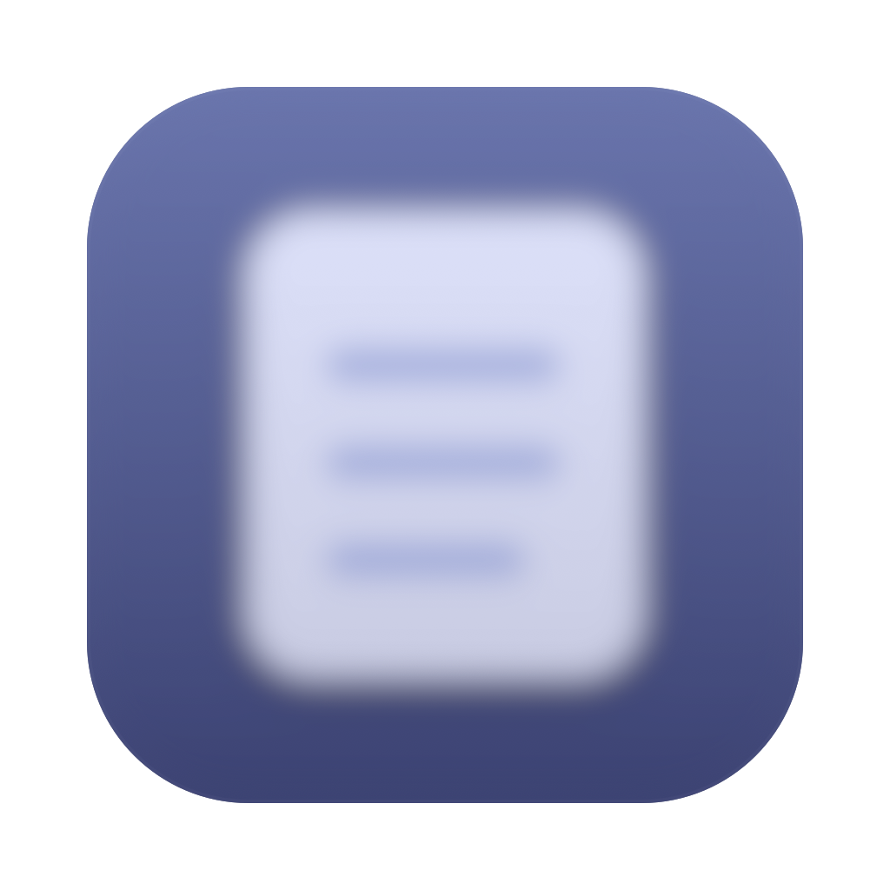

# Stealth Notes

A tiny native macOS app for presenters: float your notes above every window — including full-screen slides — while staying **invisible to screen sharing, recording and screenshots** (`NSWindow.sharingType = .none`).



## Features

- **Manager window** — native SwiftUI split view: sidebar with notes, distraction-free editor, inline rename (double-click), everything auto-saved as plain `.txt` files in `~/Library/Application Support/StealthNotes/Notes/`.
- **Overlays** — borderless rounded cards that float above all windows (full-screen apps included). Open several at once; each remembers its position. Close button appears on hover only.
- **Stealth** — overlays are excluded from screen capture: Zoom/Meet/Teams screen sharing, recordings and screenshots never see them. Only programmatic capture on this Mac is affected — a phone camera pointed at the screen still sees everything.
- **Menu bar** — toggle any note's overlay, show/hide all, or close all from the eye icon.
- **Global hotkey** — show/hide all overlays from anywhere (default ⌃⌥N, configurable).
- **Native settings** — theme, font, text size, opacity, shortcut. Standard macOS Settings tabs.

## Project layout

```
Package.swift            Swift Package Manager manifest
build.sh                 builds and (optionally) installs Stealth Notes.app
Sources/StealthNotes/
  App/                   @main app, scenes, menu bar
  Models/                Note + NotesStore (plain .txt files on disk)
  Manager/               main window: sidebar, editor, import
  Overlay/               floating panels, click-through logic, overlay view
  Markdown/              parser, SwiftUI renderer, highlighting editor
  Settings/              presets, keys, settings tabs
  Support/               Carbon global hotkeys
Resources/               Info.plist, AppIcon.icns, bundled fonts
```

## Build

```bash
./build.sh            # builds Stealth Notes.app
./build.sh --install  # builds and installs into /Applications
```

## Icon

The app icon is a static asset: `AppIcon.icns` (preview in `docs/icon.png`).

## Fonts

JetBrains Mono (OFL license) is bundled inside the app at `Contents/Resources/Fonts` and loaded via `ATSApplicationFontsPath` — no system installation required.

## Requirements

macOS 14+ (SwiftUI `MenuBarExtra`, Settings scenes). No dependencies, no Xcode project — a single `main.swift`.
